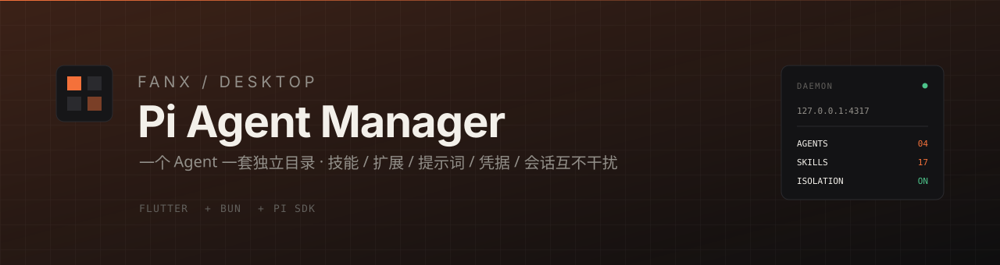
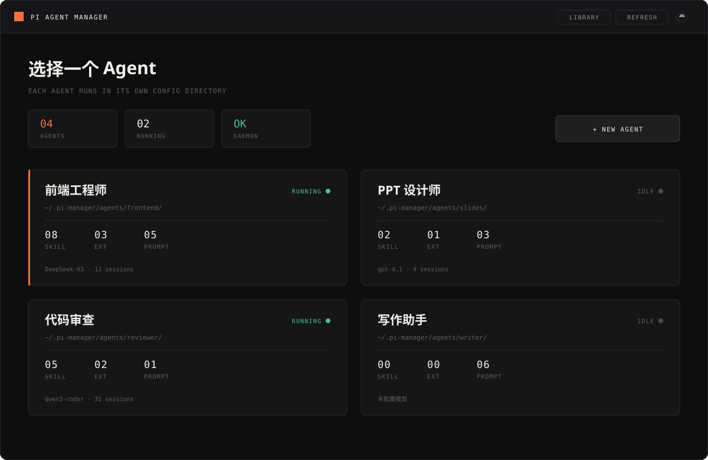
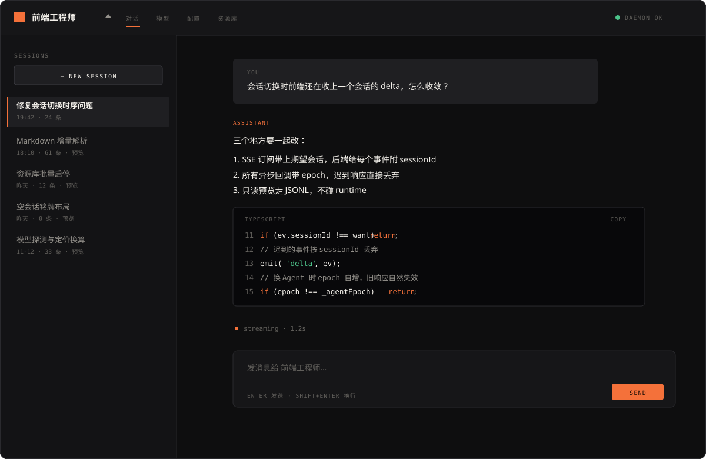
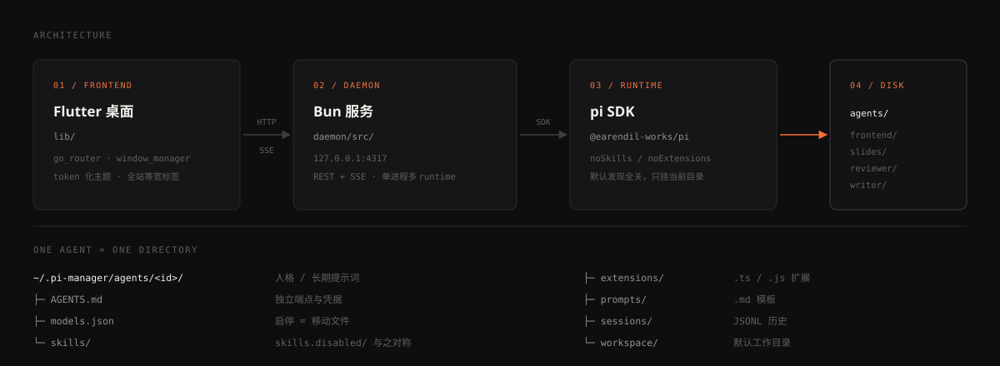

<div align="center">
  
</div>

<div align="center">

[](https://github.com/usherf233/fanx/actions/workflows/ci.yml)
[](https://flutter.dev)
[](https://dart.dev)
[](https://bun.sh)
[](https://www.typescriptlang.org)
[](https://github.com/usherf233/fanx)
[](LICENSE)

**管理多个 pi Agent 的桌面应用。每个 Agent 一套完全独立的配置目录与工作目录。**

技能、扩展、提示词、模型凭据、会话历史互不干扰 —
写代码的 Agent 装一堆代码审查技能，做 PPT 的 Agent 一个都不装，两边互不影响。

</div>

<div align="center">
  
  <br>
  <sub><b>启动页</b> · 一个 Agent 一张卡，实时读数：技能 / 扩展 / 提示词 / 运行状态</sub>
</div>

<br>

<div align="center">
  
  <br>
  <sub><b>工作区</b> · 左侧会话（点开是预览，发消息才激活）· 右侧流式 Markdown 对话</sub>
</div>

## 它解决什么

| | 常规做法 | 这个项目 |
| --- | --- | --- |
| **配置** | 所有 Agent 共享 `~/.pi/agent`、`~/.agents`，谁装了什么全家都有 | 每个 Agent 独立 `configDir`，默认资源发现全部关闭 |
| **启停技能** | 另存一份"启用状态"表，和磁盘实际内容对不上 | 直接移动文件：`skills/foo` ↔ `skills.disabled/foo` |
| **凭据** | 环境变量共享一个 key，换端点要重启 | 每个 Agent 自己的 `models.json`，可在界面里接任意 OpenAI 兼容端点 |
| **会话** | 混在一个历史里 | 存在该 Agent 的 `sessions/` 下，换 Agent 等于换整套会话 |
| **跨 Agent 复用** | 手工 `cp`，改完不知道谁在用 | 统一资源库：同一份资源装给了谁、谁停着、谁没有，一眼看完 |

## 功能

- **Agent 管理** — 卡片网格、新建 / 改名 / 改目录 / 删除（可连带删目录），启动页实时读数
- **统一资源库** — 跨 Agent 的能力总账，同名资源自动合并，在已启用 / 已停用 / 未安装之间一键切换，未安装时从别的 Agent 复制一份
- **单 Agent 资源库** — 技能、扩展、提示词同一列表分组，磁盘占用 / 告警数 / 是否真的被加载，都有读数
- **对话区** — 完整 Markdown（含表格、代码高亮、轻量 LaTeX）、流式增量解析、失败原样报错并给可行动诊断
- **模型接入** — 填 `baseUrl` 探测 `/v1/models`，自动换算 `pricing` 与 `reasoning_levels`，保存到该 Agent 自己目录
- **空会话铭牌** — 没有消息时直接列出当前模型、技能、扩展、提示词的具体名字，而不是给你几张示例提问卡
- **离线不白屏** — 连不上 daemon 时给启动命令和重试按钮

## 快速开始

需要 [Flutter](https://flutter.dev) 与 [Bun](https://bun.sh)。

```bash
git clone git@github.com:usherf233/fanx.git
cd fanx

# 1. 后端（默认 127.0.0.1:4317）
cd daemon
bun install
bun run dev

# 2. 前端（另开一个终端）
flutter run -d windows
```

前端连不上后端时，界面会直接给出离线提示和重试按钮，不会白屏。

## 架构

<div align="center">
  
</div>

pi 的 `DefaultResourceLoader` 默认会去扫 `~/.pi/agent/skills`、`~/.agents/skills`、项目 `.pi/` 等一堆位置。
放着不管，所有 Agent 会看到同一批资源，隔离就是空话。所以 daemon 里把默认发现全部关掉，只挂当前目录：

```ts
// daemon/src/runtime.ts
noSkills: true,            additionalSkillPaths: [configDir + '/skills'],
noExtensions: true,        additionalExtensionPaths: [configDir + '/extensions'],
noPromptTemplates: true,   additionalPromptTemplatePaths: [configDir + '/prompts'],
noThemes: true,
```

`noContextFiles` 特意没关 —— 让 `agentDir/AGENTS.md` 作为该 Agent 的人格生效。

**启停靠移动文件，不维护第二份状态**：外部工具（pi CLI、手改目录）看到的世界和管理器完全一致，没有"启用表"要对账。

## 仓库结构

```
fanx/
├─ lib/            Flutter 前端：core（主题/路由/API）· features（launcher/workspace/chat/library）
├─ daemon/         Bun + pi SDK 后端：src/ 服务、scripts/ 隔离性校验
├─ test/           Flutter widget 测试（注入假 daemon 的 MockClient）
├─ docs/           视觉素材与深入文档
├─ assets/         静态资源（字体目录预留）
├─ android/ ios/ web/ windows/   各平台壳工程
├─ pubspec.yaml    前端依赖
└─ README.md
```

## 开发

```bash
# 后端
cd daemon && bun run typecheck && bun run scripts/poc-isolation.ts

# 前端
flutter analyze && flutter test
```

> `poc-isolation.ts` 会建两个 Agent、各放一个技能，断言彼此看不见对方的资源。

本机设了 `HTTP_PROXY` / `HTTPS_PROXY` 时，`flutter test` 会报
`Unable to connect to flutter_tester process`。跑测试前清空代理变量：

```bash
HTTP_PROXY= HTTPS_PROXY= http_proxy= https_proxy= flutter test
```

## 文档

| 文档 | 内容 |
| --- | --- |
| [架构与隔离](docs/architecture.md) | 一个 Agent 的目录长什么样、默认资源发现怎么关、进程模型 |
| [API](docs/api.md) | daemon 的 REST 与 SSE 端点全表 |
| [设计笔记](docs/design-notes.md) | 对话区渲染与流式、模型探测、性能约定、踩过的坑 |
| [已知限制](docs/limitations.md) | 当前边界：环境变量凭据共享、单进程、无认证 |

## 版本控制

`daemon/node_modules/`、`build/`、`.dart_tool/`、`windows/flutter/ephemeral/` 等生成物，
以及 `.devhome/`（本地 Agent 配置与 auth.json）、`.workbuddy/`、`.preview/` 都由 `.gitignore` 排除。
克隆后按「快速开始」装依赖即可，不需要提交任何本地凭据。

## License

[MIT](LICENSE)
